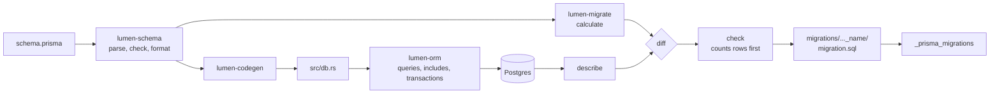

# lumen

lumen is a Prisma-style data layer for Rust. You describe your data in a `schema.prisma` file, and
lumen writes the migrations and a type-safe client for it. Under the client sits a query builder
for the queries a generated client cannot express. It works with Postgres and MongoDB.

It reads the same `schema.prisma` files Prisma reads and keeps migrations in the same folders and
history table. A project can switch between the two tools, in either direction.

**Status:** 0.1 in development, not on crates.io yet.

```console
$ lumen init
Created prisma/schema.prisma and DATABASE_URL in .env.

$ lumen migrate dev --name init
Created and applied prisma/migrations/20261115091525_init
wrote the client to src/db.rs

$ cat prisma/migrations/20261115091525_init/migration.sql
-- CreateTable
CREATE TABLE "User" (
    "id" SERIAL NOT NULL,
    "email" TEXT NOT NULL,
    "name" TEXT,
    "createdAt" TIMESTAMP(3) NOT NULL DEFAULT CURRENT_TIMESTAMP,

    CONSTRAINT "User_pkey" PRIMARY KEY ("id")
);

-- CreateIndex
CREATE UNIQUE INDEX "User_email_key" ON "User"("email");
```

That is the SQL Prisma writes for the same model, down to the constraint names.

## Install

```bash
cargo install lumen-cli
```

Release binaries for Linux, macOS and Windows are attached to each GitHub release. The same program
is also installed as `lumen-db`, for machines that already have a different `lumen` command.

## Quick start

```bash
lumen init                      # prisma/schema.prisma, .env, prisma/migrations
# point DATABASE_URL in .env at your database, add your models, then:
lumen migrate dev --name init   # writes and applies a migration, then runs `lumen generate`
```

Add `lumen-orm` to your crate and include the generated file. With MongoDB, turn on the `mongodb`
feature and run `lumen db push` instead of `migrate dev`.

```rust
#[rustfmt::skip]
mod db;

use db::{Client, post, user};

let client = Client::connect(&std::env::var("DATABASE_URL")?).await?;

let writers = client
    .user()
    .find_many()
    .filter(user::email::ends_with("@example.com"))
    .order_by(user::id::desc())
    .include_posts()
    .exec()
    .await?; // Vec<user::WithPosts>: each user with its posts, in two statements

let result = client
    .db()
    .transaction(async |tx| {
        let ana = user::on(&mut *tx).create(new_user).await?;
        post::on(&mut *tx).create(first_post(ana.id)).await?;
        Ok(ana)
    })
    .await; // both rows, or neither
```

Errors carry Prisma's codes. For example, `err.code == "P2002"` is a duplicate, and `err.fields`
names the columns. `err.http_status()` gives the status a web API should answer with.

## Filters

Every field has a module of typed conditions, and every relation field has one too. Here are the
users who wrote at least one published post about Rust and have no profile yet:

```rust
let users = client
    .user()
    .find_many()
    .filter(
        user::posts::some(
            post::published::equals(true).and(post::title::contains_insensitive("rust")),
        )
        .and(user::profile::is_null()),
    )
    .exec()
    .await?;
```

To-many relations have `some`, `every` and `none`. To-one relations have `is` and `is_not`, plus
`is_null` and `is_not_null` when the relation is optional. They nest, so
`user::posts::some(post::tags::some(tag::name::equals("rust")))` works too. They mean what they
mean in Prisma: `every` is true for a user with no posts. Text fields also have `starts_with`,
`ends_with` and `contains`, each with an `_insensitive` version. The full list is in
[docs/prisma-users.md](docs/prisma-users.md).

## How it works



*`migrate dev` diffs the schema against the real database, not against the last migration. Before a
destructive step it counts the rows that step would touch, so it only warns when data would really
be lost.*

The generated client is a plain Rust file, not a macro. You can read it, grep it, and
rust-analyzer sees every type. It calls `lumen-orm`, which you can also use directly for dynamic
queries.

## Relations without N+1

An include loads each level with one statement that has `IN (..)` over the keys, however many
parents there are. Here is the same page of users with their posts, loaded by `include_posts()` and by
a hand-written loop:


| Users (5 posts each) | `include_posts()` | A query per user |
| --- | --- | --- |
| 10 | 2 statements, 0.45 ms | 11 statements, 0.84 ms |
| 100 | 2 statements, 0.38 ms | 101 statements, 3.60 ms |
| 1,000 | 2 statements, 3.24 ms | 1,001 statements, 67.95 ms |

Measured with `cargo run --release -p lumen-codegen --example bench_includes` and drawn with
`python3 bench/plot.py`, on an i7-12700 against Postgres 16 in Docker on the same machine (median
of 21 runs, 2026-11-15). The statement counts are exact. The times move by a few milliseconds
between runs. Over a real network each statement costs a round trip, so the loop falls further
behind.

## Nested writes

`create_nested` stores a record together with related records, in one transaction. Each relation
takes new records to create and existing ones to connect by a unique key. This makes a user with
two posts and moves an older post under them:

```rust
use lumen_orm::nested::{Many, One};

let hello = post::CreateWithoutAuthor {
    id: None,
    title: "Hello".into(),
    body: None,
    published: None,
    views: None,
};
let ana = client
    .user()
    .create_nested(
        user::Create {
            id: None,
            email: "ana@example.com".into(),
            name: Some("Ana".into()),
            role: None,
            created_at: None,
            updated_at: None,
        },
        user::Nested {
            posts: Many::create(vec![
                hello.clone(),
                post::CreateWithoutAuthor { title: "Again".into(), ..hello.clone() },
            ])
            .and_connect(vec![post::UniqueWhere::Id(7)]),
            ..Default::default()
        },
    )
    .await?;
```

The user is inserted first, then both posts in one statement with `authorId` set, and post 7 is
moved to Ana. If post 7 does not exist, the call fails with P2025 and none of it is kept. The same
goes for a duplicate or any other error on the way.

From the side that holds the foreign key, `create_with_<relation>` finds or creates the related
record first:

```rust
let post = client
    .post()
    .create_with_author(
        post::CreateWithoutAuthor { title: "Hi".into(), ..hello },
        One::Connect(user::UniqueWhere::Email("ana@example.com".into())),
    )
    .await?;
```

Inside `transaction(..)` a nested write runs as a savepoint, so if it fails, the work done before
it is still there. MongoDB runs nested writes in its own transactions, so it needs a replica set.
MongoDB has no savepoints, so inside a transaction the nested write simply joins it, and returning
its error rolls back the whole thing.

## What it does

| | Postgres | MongoDB |
| --- | --- | --- |
| Schema: parse, check with "did you mean" hints, `format` like `prisma format` | yes | yes |
| `migrate dev / deploy / status / reset / diff / resolve` | yes | (uses `db push`) |
| `db push` | tables, columns, indexes, foreign keys, enums | collections and indexes |
| `db pull` | 0.2 | by sampling documents |
| Generated client: filters, ordering, paging, create, update, upsert, delete, count | yes | yes |
| Relation filters (`some`, `every`, `none`, `is`, `is_not`) | yes (`EXISTS`) | yes, except many-to-many (one extra statement per relation filter) |
| Includes, one statement per level | yes | yes (`$in`) |
| Nested writes: create with nested `create` and `connect` | yes | yes |
| Transactions | yes, with isolation levels | yes, on a replica set |
| Errors with Prisma codes (P2002, P2003, P2025, ...) | yes | yes |
| Query builder for dynamic queries | yes | yes |

## Working with Prisma

- Migrations use Prisma's layout (`YYYYMMDDHHMMSS_name/migration.sql`, `migration_lock.toml`) and
  its `_prisma_migrations` table, checksums and advisory lock.
- CI checks this against the real Prisma 6.19.3 CLI in both directions. A Prisma project carries on
  with `lumen migrate dev`, and a lumen project carries on with `prisma migrate dev`. Neither sees
  drift.
- `lumen generate` uses the generator whose provider is `lumen`. Other generator blocks, such as
  `prisma-client-js`, are left alone.

See [docs/prisma-users.md](docs/prisma-users.md) for what maps to what.

## Configuration

- The schema is `--schema`, else `./schema.prisma`, else `./prisma/schema.prisma`.
- `DATABASE_URL` (or whatever `env("..")` the datasource names) comes from the shell first, then
  from `.env` next to the schema, then from `./.env`.
- `shadowDatabaseUrl` is optional. Without it, `migrate dev` creates a temporary database and drops
  it afterwards.
- The client goes where the generator's `output` says (relative to the schema), or to `src/db.rs`.

## In CI

```bash
lumen format --check     # exit 1 when the schema is not formatted
lumen validate
lumen migrate status     # exit 1 when a migration is pending, failed, edited or missing
lumen migrate deploy     # apply pending migrations; safe for production
```

Without a terminal, a command that would lose data stops and asks you to pass
`--accept-data-loss`, so a script can't drop a column by accident.

## Limits

- No SQLite, MySQL or SQL Server. Postgres and MongoDB only.
- 0.1 is tested on Postgres 16 and MongoDB 7 on Linux. Release binaries are built for Linux, macOS
  and Windows, but the database tests only run on Linux for now.
- Planned for 0.2, not in 0.1:
  - aggregates and `groupBy`
  - cursor pagination, and ordering by the number of related rows
  - a `select` builder on `find_many`, and `utoipa::ToSchema` on the generated types
  - many-to-many and nested includes in the generated client (the query builder already has them)
  - `generate --watch`
  - `db pull` for Postgres
  - the `time` crate as an option instead of `chrono`
  - a test matrix over Postgres 13 to 17, plus database tests on macOS and Windows
  - checking the parser and formatter against Prisma's example schemas and real open-source
    projects. In 0.1 they are only checked against the schemas in lumen's own tests.
- Nested writes in 0.1 are `create` and `connect` inside a create, on one-to-one and one-to-many
  relations with a single-column key. `connect_or_create`, `disconnect`, `set` and nested writes
  inside `update` come later.
- MongoDB has no migrations, as in Prisma. `db push` creates collections and indexes, rebuilds
  an index whose definition in the schema changed, and never drops a collection. Indexes the
  schema does not have (an `@@index` you removed, or one made by hand) are listed and left in
  place; drop them yourself when they are no longer needed.

## Contributing

Bug reports with a schema that shows the problem are the most useful. The tests run without
databases. Set `LUMEN_TEST_POSTGRES_URL` and `LUMEN_TEST_MONGO_URL` (a replica set) to run the rest.
`LUMEN_TEST_PRISMA=1` also checks interop with the Prisma CLI.

## Credits

lumen's design learns from [Prisma](https://github.com/prisma/prisma-engines) (Apache-2.0) and
[SeaORM](https://github.com/SeaQL/sea-orm) (MIT OR Apache-2.0). It is written from scratch and is not
affiliated with or endorsed by Prisma.

## Licence

MIT OR Apache-2.0, at your option.

Made by the UniqTech team.
