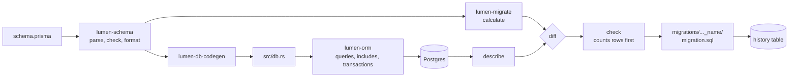

# lumen

lumen is a data layer for Rust built around one schema file. You describe your models once, and
lumen writes the migrations and a type-safe client for them. Under the client sits a query builder
for the queries a generated client cannot express. It works with Postgres and MongoDB.

**Status:** 0.1. Tested on Postgres 13 to 17 and MongoDB 7. The Limits section lists what waits for 0.2.

```console
$ lumen init
Created prisma/schema.prisma and DATABASE_URL in .env.

$ lumen migrate dev --name init
Created and applied prisma/migrations/20261115091525_init
wrote the client to src/db.rs

$ cat prisma/migrations/20261115091525_init/migration.sql
-- CreateTable
CREATE TABLE "User" (
    "id" SERIAL NOT NULL,
    "email" TEXT NOT NULL,
    "name" TEXT,
    "createdAt" TIMESTAMP(3) NOT NULL DEFAULT CURRENT_TIMESTAMP,

    CONSTRAINT "User_pkey" PRIMARY KEY ("id")
);

-- CreateIndex
CREATE UNIQUE INDEX "User_email_key" ON "User"("email");
```

The migration is plain SQL in a folder you commit. Read it, edit it before it runs, or hand it to
someone who reviews database changes.

## Install

```bash
cargo install lumen-db-cli
```

Release binaries for Linux, macOS and Windows are attached to each GitHub release. The same program
is also installed as `lumen-db`, for machines that already have a different `lumen` command.

## Quick start

```bash
lumen init                      # prisma/schema.prisma, .env, prisma/migrations
# point DATABASE_URL in .env at your database, add your models, then:
lumen migrate dev --name init   # writes and applies a migration, then runs `lumen generate`
```

The schema file holds the database, the generator and your models. `lumen init` starts it with a
`User` model. Here it also has a `Post`, which the examples below use:

```prisma
datasource db {
  provider = "postgresql"
  url      = env("DATABASE_URL")
}

generator client {
  provider = "lumen"
  output   = "../src/db.rs"
}

model User {
  id        Int      @id @default(autoincrement())
  email     String   @unique
  name      String?
  createdAt DateTime @default(now())
  posts     Post[]
}

model Post {
  id       Int     @id @default(autoincrement())
  title    String
  author   User    @relation(fields: [authorId], references: [id])
  authorId Int
}
```

Each `model` becomes a table (a collection on MongoDB). `?` makes a field optional, `[]` makes it
a list, and `@relation` says which field holds the foreign key. `lumen format` lines the file up,
and `lumen validate` explains what is wrong with it, with a "did you mean" hint for typos.

For MongoDB, start with `lumen init --provider mongodb` and run `lumen db push` instead of
`migrate dev`.

Add `lumen-orm` to your crate (with the `mongodb` feature for MongoDB) and include the generated
file. The generated client does not read `.env` (the `lumen` command does), so export
`DATABASE_URL` or load `.env` first, for example with `dotenvy::dotenv()`.

```rust
#[rustfmt::skip]
mod db;

use db::{Client, post, user};

let client = Client::connect(&std::env::var("DATABASE_URL")?).await?;

let writers = client
    .user()
    .find_many()
    .filter(user::email::ends_with("@example.com"))
    .order_by(user::id::desc())
    .include_posts()
    .exec()
    .await?; // Vec<user::WithPosts>: each user with its posts, in two statements

let result = client
    .db()
    .transaction(async |tx| {
        let ana = user::on(&mut *tx).create(new_user).await?;
        post::on(&mut *tx).create(first_post(ana.id)).await?;
        Ok(ana)
    })
    .await; // both rows, or neither
```

On MongoDB the client is made from a URL that names the database:
`Client::new(lumen_orm::mongo::MongoDb::connect_url(&url).await?)`, or
`Client::connect(&url, "app")` to name the database apart from the URL.

Errors carry stable codes. For example, `err.code == "P2002"` is a duplicate, and `err.fields`
names the schema fields of the unique constraint (or MongoDB index) it broke, `["email"]` or
`["lang", "title"]`. `err.http_status()` gives the status a web API should answer with.

### Dates

A `DateTime` field is a `time` type by default: `time::PrimitiveDateTime` for the plain
`timestamp(3)` column (a UTC time, as Prisma stores it), `time::OffsetDateTime` with
`@db.Timestamptz`, `time::Date` with `@db.Date` and `time::Time` with `@db.Time`. lumen-orm
re-exports the crate as `lumen_orm::time`, and the generated types write ISO 8601 text in JSON.

To keep `chrono` types, turn on lumen-orm's `chrono` feature and ask the generator for them:

```prisma
generator client {
  provider     = "lumen"
  dateTimeType = "chrono" // NaiveDateTime, DateTime<Utc>, NaiveDate, NaiveTime
}
```

```toml
lumen-orm = { version = "0.2", default-features = false, features = ["chrono"] }
```

On MongoDB dates are BSON `DateTime` either way.

## Filters

Every field has a module of typed conditions, and every relation field has one too. Here are the
users who wrote at least one published post about Rust and have no profile yet:

```rust
let users = client
    .user()
    .find_many()
    .filter(
        user::posts::some(
            post::published::equals(true).and(post::title::contains_insensitive("rust")),
        )
        .and(user::profile::is_null()),
    )
    .exec()
    .await?;
```

To-many relations have `some`, `every` and `none`. To-one relations have `is` and `is_not`, plus
`is_null` and `is_not_null` when the relation is optional. They nest, so
`user::posts::some(post::tags::some(tag::name::equals("rust")))` works too. Note that `every` is
true for a user with no posts, and `is_not` matches a post with no author.

On MongoDB a many-to-many relation keeps a list of ids on both sides, and the filters work the same:

```prisma
model Post {
  id       String   @id @default(auto()) @map("_id") @db.ObjectId
  labelIds String[] @db.ObjectId
  labels   Label[]  @relation(fields: [labelIds], references: [id])

  @@index([labelIds])
}

model Label {
  id      String   @id @default(auto()) @map("_id") @db.ObjectId
  postIds String[] @db.ObjectId
  posts   Post[]   @relation(fields: [postIds], references: [id])
}
```

`post::labels::some(..)` first collects the ids of the labels that match, with one aggregation,
then finds the posts whose `labelIds` holds one of them. The index on `labelIds` lets that second
step use an index. Ids in the list that point at a deleted label are ignored. Keeping the two
lists in step is up to your code for now; lumen does not update one when the other changes, and
many-to-many includes are not in the generated client yet.

| Field filter | Matches |
| --- | --- |
| `equals(v)`, `not(v)` | the value, or anything else (`not` also matches NULL) |
| `is_in([..])`, `not_in([..])` | one of the values, or none of them |
| `lt`, `lte`, `gt`, `gte` | comparisons on numbers and dates |
| `contains`, `starts_with`, `ends_with` | text, each with an `_insensitive` version |
| `is_null()`, `is_not_null()` | optional fields |

Combine conditions with `a.and(b)`, `a.or(b)` and `!a`. Each filter only takes values of its
field's type, so passing text to an `Int` field does not compile.

## How it works



*`migrate dev` diffs the schema against the real database, not against the last migration. Before a
destructive step it counts the rows that step would touch, so it only warns when data would really
be lost.*

The generated client is a plain Rust file, not a macro. You can read it, grep it, and
rust-analyzer sees every type. It calls `lumen-orm`, which you can also use directly for dynamic
queries.

## Relations without N+1

An include loads each level with one statement that has `IN (..)` over the keys, however many
parents there are. Here is the same page of users with their posts, loaded by `include_posts()` and by
a hand-written loop:


| Users (5 posts each) | `include_posts()` | A query per user |
| --- | --- | --- |
| 10 | 2 statements, 0.45 ms | 11 statements, 0.84 ms |
| 100 | 2 statements, 0.38 ms | 101 statements, 3.60 ms |
| 1,000 | 2 statements, 3.24 ms | 1,001 statements, 67.95 ms |

Measured with `cargo run --release -p lumen-db-codegen --example bench_includes` and drawn with
`python3 bench/plot.py`, on an i7-12700 against Postgres 16 in Docker on the same machine (median
of 21 runs, 2026-11-15). The statement counts are exact. The times move by a few milliseconds
between runs. Over a real network each statement costs a round trip, so the loop falls further
behind.

## Nested writes

`create_nested` stores a record together with related records, in one transaction. Each relation
takes new records to create and existing ones to connect by a unique key. This makes a user with
two posts and moves an older post under them:

```rust
use lumen_orm::nested::{Many, One};

let hello = post::CreateWithoutAuthor {
    id: None,
    title: "Hello".into(),
    body: None,
    published: None,
    views: None,
};
let ana = client
    .user()
    .create_nested(
        user::Create {
            id: None,
            email: "ana@example.com".into(),
            name: Some("Ana".into()),
            role: None,
            created_at: None,
            updated_at: None,
        },
        user::Nested {
            posts: Many::create(vec![
                hello.clone(),
                post::CreateWithoutAuthor { title: "Again".into(), ..hello.clone() },
            ])
            .and_connect(vec![post::UniqueWhere::Id(7)]),
            ..Default::default()
        },
    )
    .await?;
```

The user is inserted first, then both posts in one statement with `authorId` set, and post 7 is
moved to Ana. If post 7 does not exist, the call fails with P2025 and none of it is kept. The same
goes for a duplicate or any other error on the way.

From the side that holds the foreign key, `create_with_<relation>` finds or creates the related
record first:

```rust
let post = client
    .post()
    .create_with_author(
        post::CreateWithoutAuthor { title: "Hi".into(), ..hello },
        One::Connect(user::UniqueWhere::Email("ana@example.com".into())),
    )
    .await?;
```

Inside `transaction(..)` a nested write runs as a savepoint, so if it fails, the work done before
it is still there. MongoDB runs nested writes in its own transactions, so it needs a replica set.
MongoDB has no savepoints, so inside a transaction the nested write simply joins it, and returning
its error rolls back the whole thing.

## What it does

| | Postgres | MongoDB |
| --- | --- | --- |
| Schema: parse, check with "did you mean" hints, `format` | yes | yes |
| `migrate dev / deploy / status / reset / diff / resolve` | yes | (uses `db push`) |
| `db push` | tables, columns, indexes, foreign keys, enums | collections and indexes |
| `db pull` | 0.2 | by sampling documents |
| Generated client: filters, ordering, paging, create, update, upsert, delete, count | yes | yes |
| Relation filters (`some`, `every`, `none`, `is`, `is_not`) | yes (`EXISTS`) | yes, many-to-many through id lists (one extra statement per relation filter) |
| Includes, one statement per level | yes | yes (`$in`) |
| Nested writes: create with nested `create` and `connect` | yes | yes |
| Transactions | yes, with isolation levels | yes, on a replica set |
| Errors with stable codes (P2002, P2003, P2025, ...) | yes | yes |
| Query builder for dynamic queries | yes | yes |

## Configuration

- The schema is `--schema`, else `./schema.prisma`, else `./prisma/schema.prisma`.
- `DATABASE_URL` (or whatever `env("..")` the datasource names) comes from the shell first, then
  from `.env` next to the schema, then from `./.env`.
- `shadowDatabaseUrl` is optional. Without it, `migrate dev` creates a temporary database and drops
  it afterwards.
- The client goes where the generator's `output` says (relative to the schema), or to `src/db.rs`.
  `lumen generate` uses the generator block whose provider is `lumen` and leaves other generator
  blocks alone.
- Migrations live in a `migrations` folder next to the schema, one folder per migration
  (`YYYYMMDDHHMMSS_name/migration.sql`) plus `migration_lock.toml`. The database keeps a history
  table of what was applied, with a checksum of each file, so an edited migration is noticed.

## In CI

```bash
lumen format --check     # exit 1 when the schema is not formatted
lumen validate
lumen migrate status     # exit 1 when a migration is pending, failed, edited or missing
lumen migrate deploy     # apply pending migrations; safe for production
```

Without a terminal, a command that would lose data stops and asks you to pass
`--accept-data-loss`, so a script can't drop a column by accident.

## In production

- Run `lumen migrate deploy` once per release, from the release job or before the new version
  starts, with a database user that may change the schema. It never asks anything, applies only
  the pending migration files in order, and never drops anything a migration file does not drop.
  It holds a Postgres advisory lock while it works, so two instances deploying at the same moment
  take turns and the second finds nothing left to do. It also warns about applied migrations whose
  file changed or is gone.
- Each migration file runs as one implicit transaction: if a statement fails, the whole file is
  undone and the migration is recorded as failed. The next deploy stops until you run
  `lumen migrate resolve --rolled-back <name>` (after fixing the file) or `--applied <name>`.
  A statement that cannot run in a transaction, such as `CREATE INDEX CONCURRENTLY`, has to be
  alone in its own migration file.
- Take a backup or snapshot before a deploy that changes existing tables. An `ALTER TABLE` waits
  for every open transaction on that table and blocks new ones while it waits, so put
  `SET lock_timeout = '5s';` at the top of a migration that touches a busy table, and run it
  again later if it times out.
- `Client::connect(url)` uses the driver's pool defaults: on Postgres 10 connections, 30 seconds
  to wait for a free one, idle connections closed after 10 minutes, and each one replaced after
  30 minutes. Broken connections are dropped and replaced, so the client recovers on its own when
  the database restarts. To choose the sizes, build the pool yourself:

  ```rust
  use lumen_orm::sqlx::postgres::PgPoolOptions;
  use std::time::Duration;

  let pool = PgPoolOptions::new()
      .max_connections(20)
      .acquire_timeout(Duration::from_secs(5))
      .connect(&std::env::var("DATABASE_URL")?)
      .await?;
  let client = db::Client::new(lumen_orm::Db::from_pool(pool));
  ```

  A request that waits longer than `acquire_timeout` for a connection fails with P1001 (HTTP
  503). A per-statement limit goes in the URL:
  `postgresql://..?options=-c%20statement_timeout%3D10000` (milliseconds).
- A serializable or repeatable-read transaction that conflicts, and a deadlock, fail with P2034
  (`err.http_status()` is 409), as does a write conflict between MongoDB transactions. Run the whole transaction again when you get it; lumen does not
  retry on its own, because only you know whether the work in it can be repeated.
- A transaction whose future is dropped (a timeout, a client that went away) is rolled back
  before its connection is used again.
- On MongoDB, transactions and nested writes need a replica set or a sharded cluster. A single
  server can be started as a one-member replica set (`mongod --replSet rs0`, then
  `rs.initiate()`). Pool sizes and timeouts go in the URL (`maxPoolSize`, `serverSelectionTimeoutMS`).
- `find_many` without `take` reads every matching row into memory. Page large tables with `take`
  and `skip`, or by a key: `filter(id::gt(last_id)).order_by(id::asc()).take(500)`.

## Limits

- No SQLite, MySQL or SQL Server. Postgres and MongoDB only.
- CI runs every database test on Linux against Postgres 13, 14, 15, 16 and 17 and MongoDB 7, and
  the Postgres tests on macOS and Windows against Postgres 17. The MongoDB tests run on Linux
  only: they need a replica set in Docker, which the macOS and Windows runners do not have.
- Planned for 0.2, not in 0.1:
  - aggregates and `groupBy`
  - cursor pagination, and ordering by the number of related rows
  - a `select` builder on `find_many`, and `utoipa::ToSchema` on the generated types
  - many-to-many and nested includes in the generated client (the query builder already has them)
  - `generate --watch`
  - `db pull` for Postgres
- On MongoDB a relation filter sends the keys of every related document that matches to the
  outer query as one `$in` list. A condition that matches hundreds of thousands of related
  documents makes a large query, and at around 800,000 ObjectIds it reaches MongoDB's 16 MB
  document limit. Keep such conditions narrow, or filter the other way round.
- Nested writes in 0.1 are `create` and `connect` inside a create, on one-to-one and one-to-many
  relations with a single-column key. `connect_or_create`, `disconnect`, `set` and nested writes
  inside `update` come later.
- MongoDB has no migration files. `db push` creates collections and indexes, rebuilds
  an index whose definition in the schema changed, and never drops a collection. Indexes the
  schema does not have (an `@@index` you removed, or one made by hand) are listed and left in
  place; drop them yourself when they are no longer needed.

## Guides

- Coming from Prisma? See [docs/for-prisma-users.md](docs/for-prisma-users.md).

## Contributing

Bug reports with a schema that shows the problem are the most useful. The tests run without
databases. Set `LUMEN_TEST_POSTGRES_URL` and `LUMEN_TEST_MONGO_URL` (a replica set) to run the rest.

The parser, the checker, the formatter and the migration engine are also tested against 68 real
schema files, up to 3,900 lines long, from open-source projects and example apps. They live in
[crates/lumen-schema/tests/corpus](crates/lumen-schema/tests/corpus), with their sources and
licences. A schema that lumen reads wrong is a good addition there.

## Licence

MIT OR Apache-2.0, at your option.

Made by the UniqTech team.
